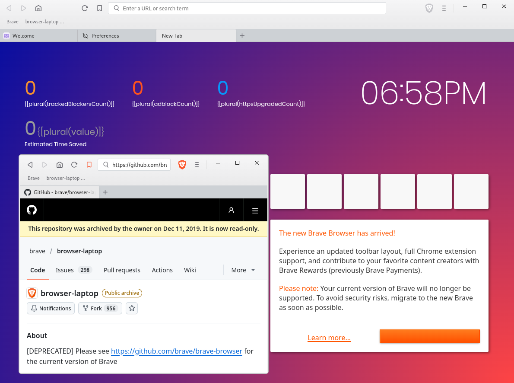

# BraveNostalgia

The [Ladybird](https://github.com/LadybirdBrowser/ladybird) browser engine wearing the old Brave browser's UI: the
Brave 0.27 / Muon-era chrome from [brave/browser-laptop](https://github.com/brave/browser-laptop).



A small weekend experiment, not a browser you should use. It is a warm-up for a browser of my own that takes the
best of Firefox and Brave/Chrome.

## How it works

Muon drew Brave's chrome in HTML, so here Ladybird does the same. The original browser-laptop React UI (tab strip,
omnibox, toolbar, bookmarks toolbar, menus, Shields panel) runs as a Ladybird WebUI page, `about:brave-chrome`. It
is shown in a web view laid over the top of each window, and Ladybird's own tab strip and toolbar are hidden. The
page and Ladybird talk over Ladybird's WebUI bridge (`ladybird.sendMessage()` and `WebUIMessage` events).
Ladybird keeps the tabs and the data; the Brave UI shows them and sends back what the user does.

While a menu or panel is open, the chrome view covers the window but shows only the toolbar and the popup. The
rest is transparent and lets clicks through to the page.

Brave's `about:` pages are served from the same bundle. Where Ladybird has a counterpart, they talk to Ladybird's
own handlers:

| Page | Backed by |
| --- | --- |
| `about:history` | Ladybird's history |
| `about:downloads` | Ladybird's downloads (open, show in folder) |
| `about:bookmarks` | Ladybird's bookmark store (move, new folder, edit/delete via context menu, import/export) |
| `about:preferences` | Ladybird's settings: search engine, suggestions, startup, new tab URL. Brave-only options (wide URL bar, home button, ...) are saved in Ladybird's settings under `brave` |
| `about:adblock` | Ladybird's content blocker lists and custom filters |
| `about:brave`, `about:newtab`, `about:passwords`, ... | Display only |

## What works

- Tabs: open, close, switch, hover close button, drag to reorder, drag out into a new window.
- Omnibox, back/forward/reload/stop, home.
- Frameless window with Brave's own minimize/maximize/close buttons; drag the empty toolbar to move the window,
  double-click to maximize.
- Bookmarks toolbar and the star button, on Ladybird's bookmarks.
- Brave's menus, right-click menus and panels, drawn over the page.
- The pages in the table above.

Not wired up: Shields' per-site switches and counts, Payments, Sync, Tor, extensions, passwords. New Private Tab
(with Tor) only shows what Brave's private new tab page looked like; the tab itself is not private. Popups have
no drop shadow over the page.

## Layout

| Path | What |
| --- | --- |
| `ladybird/` | Ladybird, with the changes for this on branch `brave-nostalgia` |
| `ladybird/UI/Qt/BraveChrome.{h,cpp}` | The chrome view and its WebUI page: tabs, window and bookmarks out, user actions in |
| `ladybird/Base/res/ladybird/about-pages/` | Host pages for `about:brave-chrome` and Brave's `about:` pages |
| `chrome/` | The browser-laptop UI, from a standalone extraction of it (BraveLegacyUI) that runs without Muon |
| `chrome/harness/ladybird/` | Boot, bridge to Ladybird, `about:` page data, CSS, and a fake Ladybird for testing |
| `scripts/sync-chrome.sh` | Builds `chrome/` and copies the bundle into Ladybird's resources |
| `scripts/run.sh` | Builds and runs Ladybird with `LADYBIRD_BRAVE_CHROME=1` |

Without `LADYBIRD_BRAVE_CHROME=1`, Ladybird is unchanged.

## Build and run

Linux with Wayland only. Ladybird needs Qt 6.10 or newer and a recent GCC or Clang; see Ladybird's
[build instructions](https://github.com/LadybirdBrowser/ladybird/blob/master/Documentation/BuildInstructionsLadybird.md).
The chrome bundle needs Node.js (webpack 3, built with `--openssl-legacy-provider`).

```bash
git clone --recurse-submodules <this repo>
./scripts/sync-chrome.sh   # builds the Brave UI bundle; again after changing chrome/
./scripts/run.sh           # builds and runs Ladybird; JOBS=4 by default, each job takes ~2 GB of RAM
```

The first Ladybird build compiles its vcpkg dependencies and takes a long time.

I build it in a Fedora 44 Incus container with the host's Wayland socket passed in at `/run/hostwl/wayland-0`;
`scripts/run.sh` uses that socket when it exists and your own `WAYLAND_DISPLAY` otherwise.

### Working on the chrome without Ladybird

`chrome/harness/ladybird/fake-ladybird.html` runs the chrome bundle in any browser against a fake `ladybird`
object that keeps a list of tabs and logs every message. Serve `chrome/` over HTTP and open it. Add `#selftest` to
click through tabs, new tab, the omnibox and back; `#menu`, `#star` and `#ctx` open the menu, the bookmark
hanger and a tab's right-click menu.

## Messages between the chrome and Ladybird

| Direction | Name | Data |
| --- | --- | --- |
| Ladybird → page | `tabsChanged` | `{tabs: [{id, title, url, favicon, loading, active, canGoBack, canGoForward, isPrivate}], window: {maximized, fullScreen}}` |
| Ladybird → page | `bookmarksChanged` | Ladybird's bookmark tree |
| Ladybird → page | `braveSettingsChanged` | Brave-only preferences |
| Ladybird → page | `dismissPopups` | The user clicked the page while a popup was open |
| page → Ladybird | `chromeReady`, `reload`, `stop` | none |
| page → Ladybird | `newTab` | `{url}` |
| page → Ladybird | `navigate` | `{tabId, url}` (raw omnibox text; Ladybird decides URL or search) |
| page → Ladybird | `activateTab`, `closeTab`, `goBack`, `goForward`, `detachTab` | `{tabId}` |
| page → Ladybird | `moveTab` | `{tabId, index}` |
| page → Ladybird | `closeWindow`, `minimizeWindow`, `maximizeWindow`, `unmaximizeWindow`, `toggleMaximizeWindow`, `startWindowDrag` | none |
| page → Ladybird | `bookmarkAdd`, `bookmarkEdit`, `bookmarkMove`, `bookmarkRemove`, `bookmarkAddFolder`, `bookmarkEditFolder` | bookmark ids, URLs, titles, folders |
| page → Ladybird | `setChromeHeight` | `{height, overlay, region}`: toolbar height, and while a popup is open the rectangles to show |

## Credits and licenses

- The UI in `chrome/` is from [brave/browser-laptop](https://github.com/brave/browser-laptop) (archived), under the
  Mozilla Public License 2.0; see `chrome/LICENSE`.
- [Ladybird](https://github.com/LadybirdBrowser/ladybird) is under the BSD 2-Clause license; see
  `ladybird/LICENSE`. The changes made here are under the same license.

Brave and the Brave lion are trademarks of Brave Software. This project is not affiliated with Brave Software or
the Ladybird Browser Initiative.
